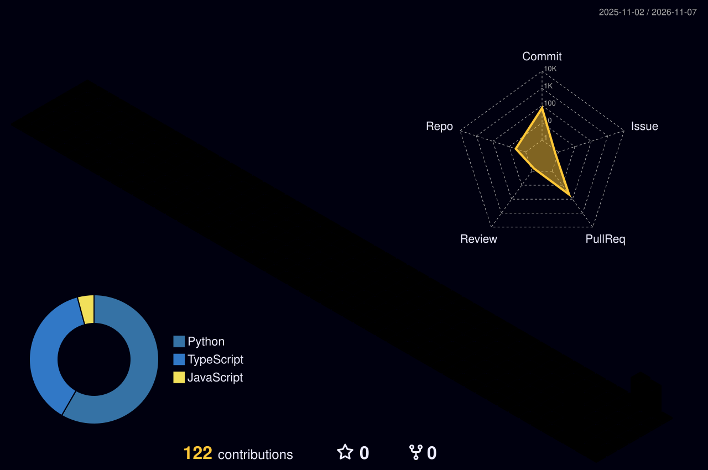

  
  
  

  
  
  

  

  

  <picture>
    <source media="(prefers-color-scheme: dark)" srcset="assets/snake-dark.svg" />
    <source media="(prefers-color-scheme: light)" srcset="assets/snake.svg" />
    
  </picture>

Every visual on this page is regenerated daily by GitHub Actions from live GitHub data.

