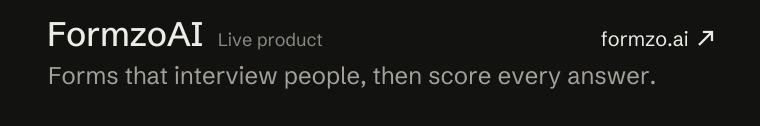
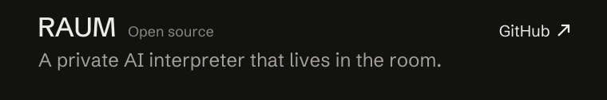
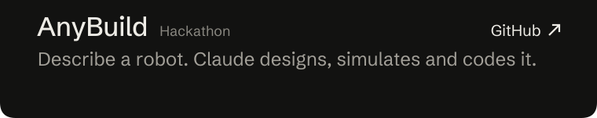

<picture><source media="(max-width: 600px)" srcset="assets/title-m.svg"></picture><a href="https://formzo.ai"><picture><source media="(max-width: 600px)" srcset="assets/work-formzo-m.svg"></picture></a><a href="https://github.com/Motion-graphics-enxa/raum"><picture><source media="(max-width: 600px)" srcset="assets/work-raum-m.svg"></picture></a><a href="https://github.com/TheWingTheWong/anybuild_hackathon"><picture><source media="(max-width: 600px)" srcset="assets/work-anybuild-m.svg"></picture></a>

